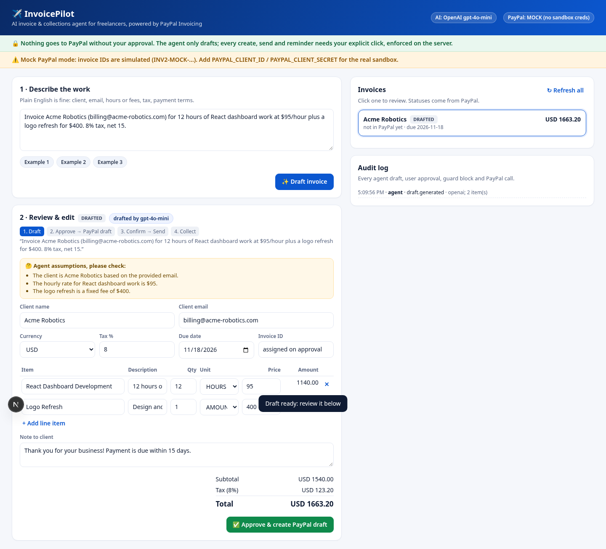

# ✈️ InvoicePilot: AI invoice & collections agent

Freelancers describe the work in plain English. InvoicePilot's agent drafts a structured invoice, you review and edit it, and **only after your explicit approval** is it created in PayPal (Invoicing API v2). Later the agent checks status and drafts payment reminders, which again go out only when you approve them.

> 🔒 **Nothing goes to PayPal without your approval.** The rule is enforced on the server by single-use, content-bound approval tokens and a state machine, not just by the UI.

🎬 **Demo video (2:22):** [docs/demo.mp4](docs/demo.mp4), recorded against the real PayPal Sandbox.



## Features
- **Natural language → invoice**: OpenAI `gpt-4o-mini` with strict JSON-schema structured outputs, validated again with Zod. The agent lists its *assumptions* (for example a missing email) for you to check.
- **Editable review**: every field can be edited, with live validation, minor-unit totals (no float drift) and tax.
- **Human-in-the-loop PayPal writes**: *Approve → create PayPal DRAFT* → *Confirm → send to client* → *Approve → send reminder*. Each is a separate explicit confirm.
- **Collections**: status refresh per invoice or for all, plus AI reminder drafting with tone that escalates with each reminder sent, editable before sending.
- **🤖 Collections agent**: one click refreshes every open invoice from PayPal, classifies each one as paid, overdue, due soon or open, and drafts AI reminders for overdue and due-soon invoices. The reminders are queued for your approval and never sent automatically. AI calls are capped per run (`POST /api/collections`).
- **Cash-flow dashboard + live status**: Outstanding, Overdue, Paid and Drafts totals per currency. Sent invoices are polled from PayPal every 20 s, and a toast appears the moment one is paid.
- **Import any PayPal invoice** by `INV2-…` ID (read-only Invoicing v2 GET, `POST /api/import`) so the agent can track invoices you created elsewhere.
- **Audit log** of every agent draft, user approval, guard block and PayPal call.
- **Runs with zero keys**: an offline mock parser and a clearly labelled **mock PayPal** mode (IDs `INV2-MOCK-…`).

## Architecture
```mermaid
flowchart LR
  U[Freelancer] -->|plain English| UI[Next.js UI app/page.tsx]
  UI -->|POST /api/drafts| API[Next.js API routes]
  API --> LLM[lib/llm.ts<br/>OpenAI structured outputs + Zod<br/>mock fallback]
  API --> ST[(data/db.json<br/>drafts · approvals · audit)]
  UI -->|explicit Approve click<br/>POST /approve confirm:true + contentHash| G[lib/approval.ts<br/>approval guard + state machine]
  G -->|single-use token| UI
  UI -->|POST /execute X-Approval-Token| API
  API -->|consume token| G
  G -->|ok| PP[lib/paypal<br/>gateway]
  PP -->|creds missing| MOCK[mock PayPal]
  PP -->|create| REST[REST client<br/>OAuth token cache<br/>api-m.sandbox.paypal.com]
  PP -->|get / send / remind| TK[@paypal/agent-toolkit<br/>invoice tools]
  REST & TK --> PAYPAL[(PayPal Sandbox<br/>Invoicing v2)]
```

| Layer | Path | Notes |
|---|---|---|
| Schema | `lib/schema.ts` | Zod `InvoiceDraftSchema` plus a matching strict JSON schema for OpenAI |
| Totals | `lib/totals.ts` | integer minor units, zero-decimal currencies (JPY) |
| LLM | `lib/llm.ts` | `parseInvoice`, `draftReminder`; prompt treats user text as data; deterministic `mockParse` |
| Approval guard | `lib/approval.ts` | state machine `DRAFTED→CREATED→SENT→PAID`; tokens are random, stored hashed, single use, expire after 10 min, and are bound to draft id + action + SHA-256 of the exact content approved |
| PayPal | `lib/paypal/*` | `rest.ts` (OAuth client-credentials, cached until 60s before expiry, `PayPal-Request-Id` idempotency), `toolkit.ts` (official Agent Toolkit `get_invoice`/`send_invoice`/`send_invoice_reminder`), `mock.ts`, `payload.ts` (draft → Invoicing v2 body) |
| Service | `lib/service.ts` | the only code path to PayPal writes: `execute()` consumes approval → calls the gateway → records |
| API | `app/api/**` | `drafts`, `drafts/[id]`, `[id]/approve`, `[id]/execute`, `[id]/status`, `[id]/reminder`, `audit`, `health` |
| Store | `lib/store.ts` | atomic JSON file (`data/db.json`, git-ignored) |

## Setup
Requirements: Node 20+ and pnpm.
```bash
pnpm install
cp .env.example .env.local   # fill in what you have; everything is optional
pnpm dev                     # http://localhost:3000
```

### PayPal sandbox credentials
1. Sign in at <https://developer.paypal.com/> (a free PayPal account works).
2. **Testing Tools → Sandbox Accounts**: a default *Business* (merchant) and *Personal* (buyer) account are created for you. Use the Personal account's email as the client email to see the invoice arrive in the sandbox.
3. **Apps & Credentials** → make sure the toggle says **Sandbox** → **Create App** (Merchant type, linked to the sandbox business account).
4. Copy the **Client ID** and **Secret** into `.env.local` as `PAYPAL_CLIENT_ID` / `PAYPAL_CLIENT_SECRET`, then restart `pnpm dev`. The header badge changes from **PayPal: MOCK** to **Sandbox**.
5. To see the invoices, log in to <https://www.sandbox.paypal.com/> with the sandbox business account.

The app only ever talks to `api-m.sandbox.paypal.com`. Secrets are read from env vars and never logged or returned by any API.

### OpenAI
Set `OPENAI_API_KEY` (model `gpt-4o-mini` by default, about $0.001 per draft). Without it, a deterministic regex parser drafts invoices and the UI says so.

## Scripts
```bash
pnpm lint && pnpm typecheck && pnpm test && pnpm build
```
`vitest` covers parsing and normalisation, the schema rules, the PayPal payload mapping, totals and the approval guard (missing, replayed, expired, cross-action and post-edit tokens, the state machine and invalid drafts).

## Safety design
- **The agent can't write to PayPal.** The LLM only returns JSON. Every PayPal write goes through `service.execute()`, which first consumes a server-issued approval token.
- **You approve what you saw.** The approve call must send the content hash the UI rendered. If the stored draft differs, approval is refused, and editing after approval invalidates the token.
- **Two-step send**: creating in PayPal makes a DRAFT invoice only. Emailing the client is a second, separate confirm, and reminders are a third.
- **State machine** blocks out-of-order or repeated writes (for example create twice, or remind before send).
- **Prompt-injection hygiene**: user text is fenced as data, outputs are schema-constrained and re-validated, and assumptions are surfaced, never silently invented (no fabricated emails).
- **Audit log** records guard blocks as well as successes.
- **Mock modes are labelled** in the UI, the API (`/api/health`) and invoice IDs.

## Demo flow
See [HACKATHON.md](HACKATHON.md) for the 2–3 minute video script. Screenshots are in [`docs/`](docs/).
